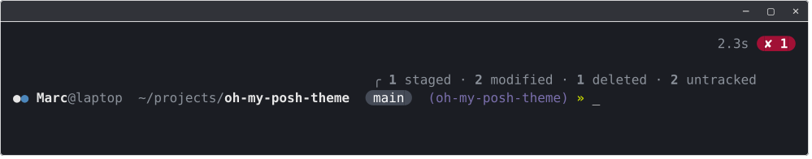
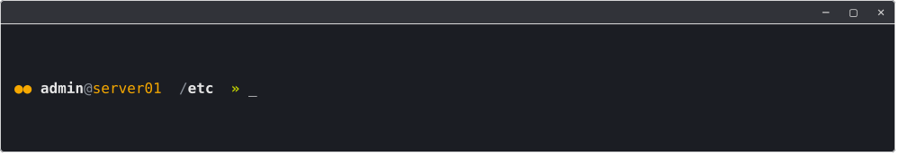
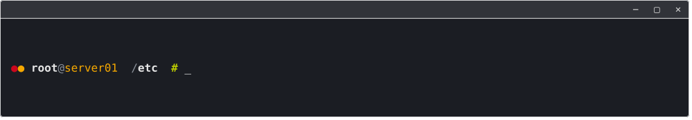
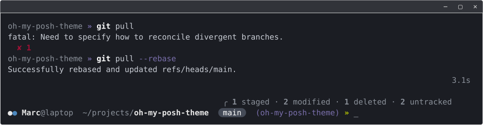

# oh-my-posh-theme · mw88

A cross-platform [oh-my-posh](https://ohmyposh.dev) theme for PowerShell 7 and bash (locally in
WSL and over SSH on Linux servers) in Windows Terminal. The goal: **see the important things at a
glance – who am I, where am I, what state am I in – and keep everything else as quiet
information.**

The repository contains only the theme (`mw88.omp.json`) and documentation. How the theme is hooked
into each system is deliberately left to the platform and described in [`docs/`](docs/).

---

## Preview

Local, in a git repository with changes, right after a failed command:



Remote host, as a normal user and as root:





A short session: the transient prompt (PowerShell only) shrinks previous commands to dots, folder
and `»`, separated by a blank line; an error stays visible below its output, and the current prompt
is shown in full:



---

## Prompt layout

| Line           | Content                                                                                                                   | When shown                                                     |
| -------------- | ------------------------------------------------------------------------------------------------------------------------- | -------------------------------------------------------------- |
| Status         | Duration of the previous command (from 2 s) and exit code (`✘ n`, bordeaux box), right-aligned                            | always present as a line; empty without an error and under 2 s |
| Blank line     | Spacing between status and prompt                                                                                         | always                                                         |
| Git annotation | `╭ n staged · n modified · n deleted · n untracked · n conflict · n stashed`; the hook sits exactly above the branch name | only in git repositories with changes or stashes               |
| Prompt         | Dots · `user@host` · path · git branch · venv · input symbol – input starts on the same line                              | always; branch and venv only when present                      |

The status line belongs to the **previous** command and sits directly below its output. The
annotation describes the **current** state and therefore sits directly above the prompt.

### The two dots

The **first dot** shows *who* you are, the **second** shows *where* you are.

| Situation                  | First dot | Second dot | Host name | Input |
| -------------------------- | --------- | ---------- | --------- | ----- |
| User, local (Windows, WSL) | light     | blue       | grey      | `»`   |
| User, remote               | orange    | orange     | orange    | `»`   |
| root/Administrator, local  | red       | blue       | grey      | `#`   |
| root/Administrator, remote | red       | orange     | orange    | `#`   |

The theme detects local vs. remote on its own: Windows or WSL counts as local, everything else as
remote – including a server console without SSH.

### Git

| Element                | Meaning                                                  |
| ---------------------- | -------------------------------------------------------- |
| Box with branch name   | current branch (or commit when HEAD is detached)         |
| `↑n` / `↓n` in the box | commits ahead / behind the upstream; no arrows = in sync |
| `staged`               | staged (`git add`)                                       |
| `modified`             | modified, not staged                                     |
| `deleted`              | deleted, not staged                                      |
| `untracked`            | new, not under version control                           |
| `conflict`             | merge conflict                                           |
| `stashed`              | stash entries                                            |

A clean repository shows only the branch box, without an annotation line.

### Colours (RWTH palette)

| Colour          | Hex       | Used for                                                                  |
| --------------- | --------- | ------------------------------------------------------------------------- |
| Blue, lightened | `#4C87BC` | second dot, local                                                         |
| Orange          | `#F6A800` | dots and host name when remote                                            |
| RWTH red        | `#CC071E` | first dot for root/Administrator                                          |
| Bordeaux        | `#A11035` | error box `✘`, exit code in the transient prompt                          |
| May green       | `#BDCD00` | input symbol `»` or `#`                                                   |
| Violet          | `#7A6FAC` | small symbols: venv, `↑`/`↓`, `»` in the transient prompt                 |
| Light           | `#e6e6e6` | user name, current folder, first dot when local                           |
| Grey            | `#8b919a` | secondary information: local host name, parent path, duration, annotation |
| Dark grey       | `#454b57` | git box                                                                   |

Yellow is deliberately not used.

---

## Requirements

- **oh-my-posh** – tested with **32.1.0** (Windows, WSL). Configuration format `"version": 3`.
  On servers with an older version, test before rolling out (see [`docs/linux.md`](docs/linux.md)).
- **Nerd Font** in the terminal (for the rounded box ends ``/``) – see
  [`docs/windows-terminal.md`](docs/windows-terminal.md#font).
- **Truecolor terminal** (Windows Terminal) and a **UTF-8** locale (on Linux e.g. `en_US.UTF-8`).

---

## Installation

| Platform              | Guide                                                      | Theme location                          | Hooked in via                                |
| --------------------- | ---------------------------------------------------------- | --------------------------------------- | -------------------------------------------- |
| Windows, PowerShell 7 | [`docs/windows-powershell.md`](docs/windows-powershell.md) | `D:\usr\local\share\oh-my-posh\themes\` | `$PROFILE`                                   |
| Windows Terminal      | [`docs/windows-terminal.md`](docs/windows-terminal.md)     | –                                       | `settings.json`                              |
| WSL (Debian)          | [`docs/wsl.md`](docs/wsl.md)                               | `/usr/local/share/oh-my-posh/themes/`   | `/etc/bash.bashrc`                           |
| Linux server          | [`docs/linux.md`](docs/linux.md)                           | `/usr/local/share/oh-my-posh/themes/`   | `/etc/bash.bashrc` (manually or via Ansible) |
| cmd                   | –                                                          | –                                       | **deliberately not** (see design decisions)  |

Always install a **tagged release**, never the working copy. Each platform downloads the theme
directly from GitHub, independently of the others:

```
https://raw.githubusercontent.com/mw88-personal/oh-my-posh-theme/<tag>/mw88.omp.json
```

---

## Development and releases

Development happens locally in `D:\home\marc\projects\oh-my-posh-theme`.

**Preview without touching your own profile:**

```powershell
# render once
oh-my-posh print primary --config .\mw88.omp.json --shell pwsh
oh-my-posh print transient --config .\mw88.omp.json --shell pwsh --status 1

# test session (leave with exit)
pwsh -NoProfile -NoExit -Command "oh-my-posh init pwsh --config '$PWD\mw88.omp.json' | Invoke-Expression; Set-PSReadLineOption -PromptText ' '"
```

bash in WSL:

```bash
bash --norc
eval "$(oh-my-posh init bash --config /mnt/d/home/marc/projects/oh-my-posh-theme/mw88.omp.json)"
```

States to try: `cmd /c exit 3` or `false` (error), `Start-Sleep 3` or `sleep 3` (duration),
activate a venv, change files in the repository (annotation), test session as Administrator or
`sudo -i` (root), paths under `~` (home) and with drive letters (annotation alignment).

**Preview images:** the images in `docs/images/` are generated from the theme, not screenshots.
After changing the theme, regenerate them (in WSL or on Linux; needs oh-my-posh ≥ 32, git, python3):

```bash
./tools/render-preview.sh
```

The script creates a throw-away demo repository with a fixed set of changes, renders the prompt with
the states in `tools/preview-data/` (local with error, remote, root, plus a short session) via
`oh-my-posh config export image`, and post-processes the SVGs with `tools/fix-svg.py` so that the
rounded box ends also display without a Nerd Font (e.g. on github.com). `oh-my-posh config export
image` can only draw the primary prompt; the session image is therefore built by
`tools/session-svg.py` from the output of `oh-my-posh print transient` / `print primary`, with the
commands and their output defined at the top of that script.

**Release:**

```powershell
git add mw88.omp.json
git commit -m "…"
git tag -a vX.Y.Z -m "…"
git push --follow-tags
```

Then run the installation step with the new tag on each machine (see `docs/`). Documentation-only
changes don't need a new tag.

---

## Design decisions

- **Cross-platform theme, platform-specific integration.** The same look everywhere; how the theme
  is loaded is up to each platform (profile, `bash.bashrc`, Ansible). The theme contains nothing
  machine-specific.
- **Single-line prompt.** Input starts on the same line as user, host, path and branch. A multi-line
  prompt with a separate input line was tried (v1) and dropped.
- **Git state as an annotation.** Instead of making the prompt line longer or right-aligning the
  state next to the input (where a long command would overwrite it), the state is shown as a
  footnote above the branch. It disappears automatically in the transient prompt.
- **Two small dots instead of a host box.** Subtle but unambiguous: the first dot shows the role
  (red = root/Administrator), the second the location (blue = local, orange = remote). A split dot
  made of two half circles was dropped: the large Nerd Font half circles were too heavy, and the
  small half-circle characters leave a gap in some fonts.
- **Direct attention:** colour only for role, location, errors and input. User name and current
  folder are bold and light, everything else grey. The annotation is monochrome – colour would be
  clutter.
- **Status belongs to the previous command.** It has its own line below that command's output,
  separated from the new prompt by a blank line; the input symbol is not coloured by the status.
- **No clock in the prompt.** The duration segment covers that (from 2 s); for "when did that run?"
  the shell history is the better place (see ideas).
- **English git terms**, consistent with git itself.
- **Copy-friendly:** no separator line, no arrow separators; continuation lines start with two
  spaces instead of `>` and can be pasted back directly.
- **Contrast over colour fidelity:** no blue or bordeaux as text colour on a dark background
  (contrast ≈ 2 : 1); a lightened blue for the dot, RWTH red instead of bordeaux for root.
- **Transient prompt** with the two dots, the current folder and a violet `»`, preceded by a blank
  line so that the output of consecutive commands stays clearly separated. The dots keep role and
  location visible in the scrollback; user and host name are left out because they rarely change
  within a session. The exit code of the previous command stays as its own indented line directly
  below that command's output. The violet `»` keeps the may green `»` reserved for the current
  input.
- **cmd is left unchanged.** With the same theme, cmd could no longer be told apart from
  PowerShell; the default `C:\…>` prompt is the clearest way to recognise it.
- **Shell integration** (`shell_integration: true`) emits OSC 133 marks: Windows Terminal shows
  marks on the scrollbar and jumps between commands with Ctrl+↑/↓.
- **Window title** `user@host: folder` – the host is also visible in the tab.

---

## Known quirks

- **Annotation alignment** is computed in the template from user name, host name and path
  (character count). That's why the path in the prompt is produced by its own template rather than
  the `path` segment – both must stay identical. Characters that are double-width in the terminal
  (emoji, CJK) in the path or names shift the hook.
- **First dot when local:** its colour tag is empty (`<>●</>`), so the dot inherits the segment's
  foreground colour (`#e6e6e6`). Changing the segment colour also changes this dot.
- **Invisible characters:** oh-my-posh drops lines that contain only spaces. So that the status line
  and the blank line also appear when empty, each contains an empty Braille character (U+2800).
  Copying these lines copies it as well.
- **Rounded box ends** are Nerd Font characters (U+E0B6/U+E0B4) and end up in copied text.
- **Transient prompt** only in PowerShell (and cmd/zsh/fish/nu); bash only with ble.sh. On servers
  the full prompt stays – which makes remote sessions stand out in the scrollback.
- **In the transient prompt** only the exit code of the previous command is available, not its
  duration.
- **Colour tags in templates** must appear literally in the template; oh-my-posh does not interpret
  `<#…>` tags produced by functions (`printf`, `join`).
- **venv `.venv`** is shown with the name of the project folder (oh-my-posh default).
- **PowerShell:** the prompt ends with a space; hence `Set-PSReadLineOption -PromptText ' '`,
  otherwise PSReadLine overwrites the input symbol on syntax errors.
- **Pasting with right-click** runs each line separately in PowerShell (PSReadLine doesn't support
  bracketed paste). Ctrl+V pastes as a block if Windows Terminal doesn't bind Ctrl+V.

---

## Ideas for later

- **fzf** (fuzzy history search with Ctrl+R), **zoxide** (`z project`), **atuin** (searchable,
  synced history, self-hostable).
- **ble.sh** for bash: suggestions, syntax highlighting and a transient prompt on Linux too.
- PSReadLine suggestions as a list: `Set-PSReadLineOption -PredictionViewStyle ListView`.

---

## Versions

| Tag      | Content                                                                                                       |
| -------- | ------------------------------------------------------------------------------------------------------------- |
| `v0.1.0` | Starting point: the theme as it ran on the servers before the redesign                                        |
| `v1.0.0` | Multi-line design: status line, host box, git line, separate input line, transient and secondary prompt       |
| `v2.0.0` | Single-line prompt: role and location dots, git annotation above the branch, blank line after the status line |
| `v2.1.0` | Transient prompt with role and location dots and a blank line before each previous command                    |
